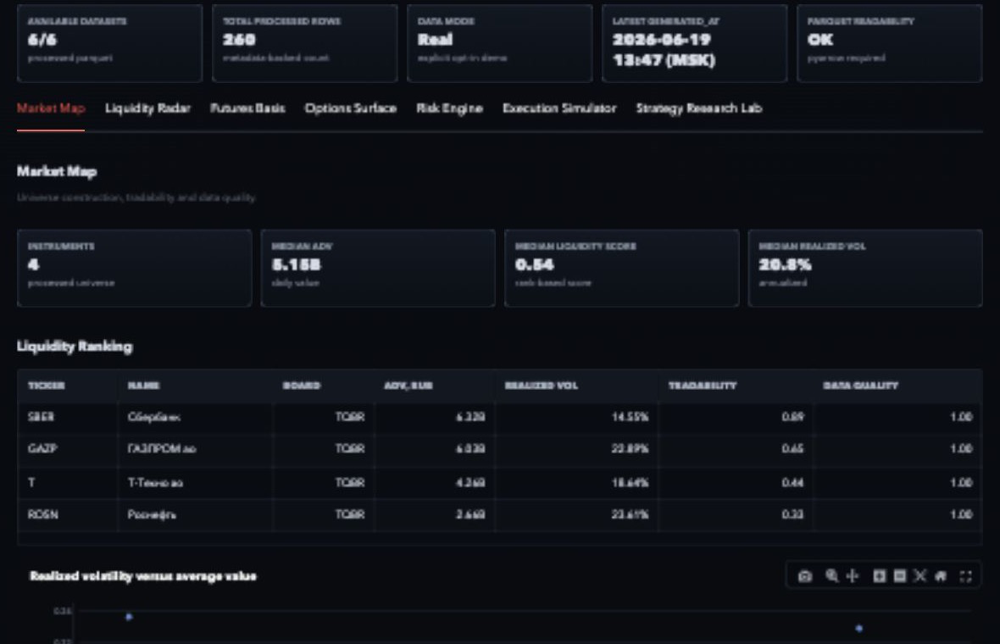
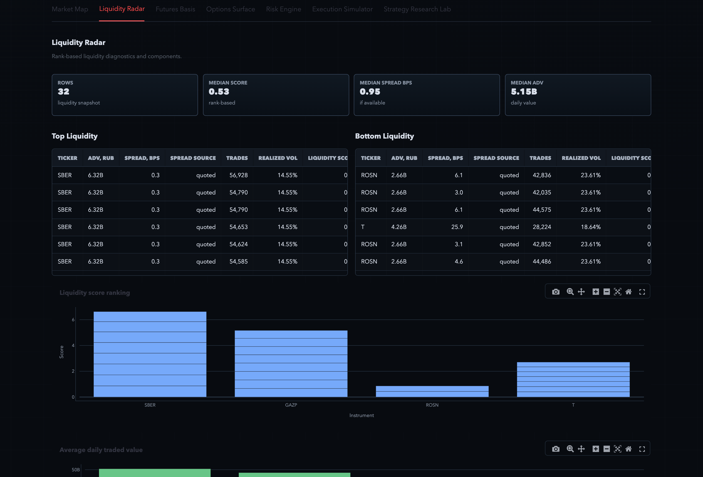

# Russian Markets Lab

[](https://github.com/sergey-lastochkin/russian-markets-lab/actions/workflows/ci.yml)

собираю открытые данные Мосбиржи (MOEX ISS) в аккуратные наборы и смотрю на них в дашборде: ликвидность, фьючерсный базис, исторический риск. это не торговый робот и не сигналы, это лаборатория.



с MOEX ISS данные приходят с задержками, дырами и в неудобном виде. поэтому у каждого Parquet-файла рядом лежит, откуда он, когда собран, сколько строк и какие у него ограничения. если данные устарели или биржа не ответила, дашборд так и показывает, а не рисует нули как будто это факт.

посмотреть дашборд можно без запросов к бирже, на сохранённом наборе:

```bash
git clone https://github.com/sergey-lastochkin/russian-markets-lab.git
cd russian-markets-lab
python -m venv .venv && source .venv/bin/activate
pip install -r requirements.txt && pip install -e .
python -m russian_markets_lab.cli dataset-status
streamlit run src/russian_markets_lab/dashboard/app.py
```

а обновить с биржи так:

```bash
python -m russian_markets_lab.cli build-all --tickers-limit 30 --lookback-days 365
```

в репозитории лежит набор от `2026-06-19`, 6 таблиц и 260 строк: инструменты, радар ликвидности, базис фьючерсов, опционная доска, сравнение исполнения. метаданные к каждому - в [data/processed](data/processed/).



откуда данные - в [источниках](docs/data_sources.md), как считал - в [методике](docs/methodology.md), как проверял целостность - в [аудите](docs/data_integrity_audit.md).

пара оговорок. набор от 19 июня 2026 - это не сегодняшний рынок, перед выводами смотрите время сборки и флаг `is_demo`. в открытых данных нет полного стакана, маршрута брокера и реального исполнения. риск и стоимость исполнения - оценки по истории с допущениями, а не прогноз. CI проверяет код на сохранённых данных и не ходит на биржу.

Сергей Ласточкин · [t.me/metaanswer](https://t.me/metaanswer) · [другие проекты](https://github.com/sergey-lastochkin)
